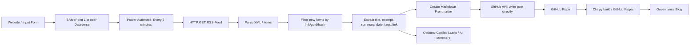

# Architektur: RSS-gestützter Governance-Blog mit Power Automate und GitHub

## Ziel

Ein Power Automate-Flow prüft alle 5 Minuten RSS-Feeds aus einer Liste von eingetragenen Websites. Neue Artikel werden direkt als Blog-Posts in das GitHub-Repository geschrieben. Es gibt keinen separaten Zwischenpuffer im Sinne einer `FeedArticles`-Liste; die Prüfung, Transformation und Veröffentlichung erfolgen im selben Flow direkt auf GitHub.

Die Idee ist dabei nicht nur ein reiner RSS-Aggregator, sondern ein governance-orientierter Content-Feed zu Themen wie:

- Power Platform Governance
- Security & Compliance
- DLP, Environments, ALM
- Dataverse, Power Apps, Power Automate, Copilot Studio
- Architektur- und Operations-Patterns

## Gesamtarchitektur



## Datenmodell

### 1) Liste: WebsiteSources

| Feld | Typ | Zweck |
|---|---|---|
| Name | Text | Bezeichnung der Quelle |
| WebsiteUrl | URL | Hauptseite der Quelle |
| RssUrl | URL | RSS-Feed URL |
| IsActive | Ja/Nein | Aktiv / inaktiv |
| LastChecked | Datum | Letzte Abfrage |
| LastStatus | Text | Letzter Status |
| Tags | Text | Kategorien / Stichworte |

### 2) Direkt-Import ohne Zwischenlagerung

Es gibt keine separate `FeedArticles`-Tabelle mehr. Jeder neue Feed-Eintrag wird direkt nach der Prüfung sofort als Markdown-Post in GitHub geschrieben.

Nur noch relevant:

- Quelle in `WebsiteSources`
- Hash / Link / GUID für Deduplizierung
- `LastStatus` für Fehler- und Laufzeit-Log

Das heißt konkret: Der Flow prüft ein RSS-Item, entscheidet ob es neu ist, und schreibt dann sofort ein neues Post-File nach `_posts/` auf GitHub.

## Power Automate-Flow

### Trigger

- Recurrence
  - Interval: 5 minutes
  - Time zone: Europe/Zurich

### Schritte

1. Liste aller aktiven `WebsiteSources` abrufen
2. Für jede RSS-URL:
   - HTTP GET auf `RssUrl`
   - XML als Antwort verarbeiten
3. Jede `<item>` / `<entry>` prüfen
4. Titel, Link, Description, Summary, PubDate oder Guid extrahieren
5. Prüfen, ob der Artikel schon verarbeitet wurde
  - anhand `Guid`, `Link`, `HashKey`
6. Wenn neu: direkt Markdown-Datei erzeugen
7. Direkt über GitHub API in `_posts/` schreiben
8. Optional:
   - AI-Aktion für Summary / TL;DR
   - Text aus Artikel-URL abrufen, sofern RSS ungenau ist

Wichtig: Es gibt kein `FeedArticles`-Write in einer separaten Tabelle. Der relevante Commit auf GitHub ist der eigentliche Import.

## RSS-Parsing-Logik

Wichtig ist, dass man robust mit unterschiedlichen Feed-Typen umgeht:

- RSS 2.0
- Atom
- ggf. JSON Feed

Typische Felder:

- `title`
- `link`
- `description` oder `summary`
- `published` oder `pubDate`
- `guid` oder `id`

### Beispiel-Logik

```text
For each item
  title = item.title ?? item['title']
  link = item.link ?? item['link']
  excerpt = item.description ?? item.summary ?? item.contentSnippet ?? first 180 chars
  publishedDate = item.pubDate ?? item.published ?? now
  guid = item.guid ?? item.id ?? link
  hashKey = SHA256(title + link)
```

## Zweisprachige Veröffentlichung

Jeder importierte Artikel wird in zwei eigenständigen Sprachversionen veröffentlicht:

```text
/de/2026/09/18/dlp-policies/
/en/2026/09/18/dlp-policies/
```

Beide URLs sind indexierbar. Die Sprachversionen werden über `hreflang` miteinander verknüpft und enthalten jeweils einen sichtbaren Link zur anderen Sprache.

Regeln:

- Die Originalsprache bleibt unverändert als Originalinhalt erhalten.
- Foundry erzeugt über den Custom Connector die jeweils andere Sprachversion.
- Titel, Excerpt, TL;DR, Kategorien und Tags werden pro Sprache erzeugt.
- `source_url` verweist in beiden Versionen auf den Originalartikel.
- Die URLs erhalten denselben stabilen Artikel-Identifier und nur unterschiedliche Sprachpräfixe.
- Es gibt keinen `#de`- oder `#en`-Anker als Sprachidentifikation für Google.

Beispielhafte Dateien:

```text
_posts/2026-09-18-dlp-policies-de.md
_posts/2026-09-18-dlp-policies-en.md
```

Das Frontmatter muss mindestens `lang`, `original_language`, `translation_url`, `source_url` und einen sprachspezifischen `permalink` enthalten.

## Markdown-Format für Chirpy

Jeder neue Beitrag wird als `.md`-Datei im Ordner `_posts/` erzeugt.

Beispiel:

```yaml
---
title: "Power Platform Governance – DLP und Environment Strategy"
categories:
  - Governance
tags:
  - power-platform
  - governance
  - dlp
  - security
  - environment-strategy
image:
  path: /assets/img/cover-governance.jpg
  alt: "Power Platform Governance"
author: Marcel Lehmann
date: 2026-09-18 09:00:00 +0100
excerpt: "Praktische Leitlinien für sichere und skalierbare Power Platform-Umgebungen."
source_url: "https://example.com/article"
source_name: "Example Blog"
lang: de
original_language: en
translation_url: "https://powerplatformgovernance.com/en/2026/09/18/dlp-policies/"
permalink: /de/2026/09/18/dlp-policies/
---

## Kurzfassung

...

## TL;DR

- ...
- ...
- ...

## Aus dem Artikel

...
```

## GitHub-Commit-Pfad

### Option A: GitHub REST API direkt

- GitHub PAT oder GitHub App
- Repository `MarceLehmann/powerplatformgovernance`
- Endpoint: `POST https://api.github.com/repos/{owner}/{repo}/contents/{path}`
- Inhalt als Base64 encodieren
- Commit Message: `Add post: {title}`

### Option B: GitHub Action

- Power Automate schreibt neue Markdown-Dateien in ein Branch-Artifact / vorbereitete Datei
- GitHub Action prüft Einträge, baut Site neu und deployed
- Für produktive Nutzung oft besser als direkte Commit-API

Empfehlung: Einstieg mit direct API, später mit Action-Workflow skalieren.

## AI / Copilot Erweiterung

Die Übersetzung und Zusammenfassung läuft nicht über den AI Builder. Power Automate ruft dafür den eigenen Custom Connector auf, der mit Foundry verbunden ist.

- Ein Copilot Studio Agent durchsucht die Blogbeiträge nach Governance-Themen
- Foundry erkennt die Originalsprache
- Foundry erzeugt die zweite Sprachversion
- Foundry erzeugt sprachspezifischen Excerpt und TL;DR
- Power Automate schreibt beide Markdown-Dateien direkt nach GitHub

### Beispiel-Fluss

```text
RSS item -> extract title + description
Custom Connector -> Foundry: detect language + translate + summarize
Create German markdown -> commit to GitHub
Create English markdown -> commit to GitHub
Add hreflang links -> Chirpy build
```

## Sicherheits- und Qualitätsregeln

- Keine fremden Artikel unverändert übernehmen, ohne Quelle zu behalten
- `source_url` immer mit speichern
- Duplikate vermeiden
- Keine personenbezogenen Daten oder interne Informationen aus fremden Quellen mitnehmen
- Tags sauber normalisieren
- nur aktive Feed-URLs verarbeiten
- Fehlergrenzen sauber protokollieren in `LastStatus`
- Kein Zwischenspeichern in einer eigenen Feed-Tabelle, wenn der Post direkt auf GitHub landen kann

## Empfohlener Rollout

### Phase 1 – MVP

- Liste mit 10–20 RSS-Feeds
- Prüfen alle 5 Minuten
- nur neue Artikel importieren
- Markdown-Dateien schreiben
- GitHub-Commit

### Phase 2 – Quality

- Foundry-Übersetzung über den Custom Connector
- sprachspezifische AI-Summary / TL;DR
- Titel- und Excerpt-Normalisierung
- Deduplizierung über HashKey / GUID
- Feeds kategorisieren

### Phase 3 – Produktiv

- Eingabeformular für neue Websites
- Moderations-Workflow
- Standard-Tag-Liste
- Suche / Filter / Copilot Studio Agent

## Empfehlung

Die robusteste Lösung ist:

1. SharePoint-Liste oder Dataverse als Source of Truth
2. Power Automate als Cron-Worker alle 5 Minuten
3. XML-Parsing der RSS-Feeds
4. Frontmatter-gesteuerte Markdown-Dateien
5. GitHub API als Commit-Layer
6. Chirpy für Rendering und Publication

Die entscheidenden Regeln sind: Feed-Artikel werden nicht zwischengespeichert, sondern direkt als zwei sprachspezifische GitHub-Post-Dateien geschrieben. Beide Sprachversionen sind über eigene URLs erreichbar und für Google indexierbar. Die Übersetzung und Zusammenfassung übernimmt der eigene Foundry-Custom-Connector.

## Nächster konkreter Umsetzungsschritt

Als erster Schritt sollte die Datenstruktur in SharePoint oder Dataverse definiert werden und ein erster Test-Flow mit 2–3 bekannten Governance-Feeds gebaut werden.

Dann folgt:

- RSS-Feed parsing
- Deduplikation
- Markdown-Datei-Generierung
- GitHub Commit
- anschließend AI Summary / TL;DR
