# Submission and moderation architecture

**Updated 30 September 2026** from the code (commit `4f34575`). The decision of 18 September 2026 (manual approval of each submission) no longer applies: since 24 September an **autonomous gate** decides new submissions without human review. The [automation operations guide](2026-09-18_architektur_automation_betrieb.md) records the implemented model, the gate, the time limits and the known gaps.

## Purpose

The site accepts suggested URLs through a JSON submission handler. Every suggestion is stored as source type `Article`; if the fetched response looks like a feed, the processing flow turns it into an `RSS` source. YouTube videos and podcast episodes are supported by the processing flow, but not through public suggestions (see "Approval state"). Direct public webhook access was explicitly approved on 18 September 2026 after discussing spam and capacity risks. The callback is injected through an Actions build secret and is intentionally visible in rendered HTML, not stored in Git history. Public suggestions always start unapproved and disabled; the processing flow then decides them autonomously (feed detection without a relevance check, or the AI quality gate for a single page). The [operations guide](2026-09-18_architektur_automation_betrieb.md#website-webhook) records the actual state; the [curation and source rules](2026-09-18_architektur_kuration_und_quellen.md) define the editorial and privacy contract.

## Flow

```mermaid
flowchart LR
    A[Public submission page] --> B[Power Automate HTTP trigger]
    B --> C[Validate and normalise payload]
    C --> D[Dataverse - unapproved and disabled]
    D --> H[Scheduled flow: autonomous gate]
    H -->|response looks like a feed| R[Approved and enabled as RSS]
    H -->|single page| G[Foundry quality gate]
    G -->|meets criteria| R2[Approved and enabled]
    G -->|does not| X[Rejected and disabled]
    H -->|check, fetch or gate call fails| W[Stays awaiting approval, retried every 5 minutes]
    R --> E[Scheduled flow and custom connector]
    R2 --> E
    E --> F[Foundry relevance and quality assessment]
    F -->|single page judged not publishable| N[Needs review, no retry]
    F --> I[Create short attributed summaries]
    I --> J[Dispatch structured data to the publisher workflow]
    J --> K[Publisher writes the posts, card images, Chirpy and GitHub Pages]
```



## Intake payload

The form sends these fields:

- `content_url`: the only required field; article, blog, RSS/Atom, YouTube or podcast URL, HTTPS only
- `submitter_name`: optional
- `submitter_linkedin`: optional personal LinkedIn profile URL
- `publish_credit`: `yes` only when the optional checkbox is selected; absent means no permission

No email, title, topics, source name or language is requested. The optional `website` honeypot must be empty. The intake stores every submission as source type `Article`; the scheduled flow detects feeds when it fetches the URL and sets the source type to `RSS` itself. Metadata is fetched only by that scheduled flow, never by the intake. Dataverse supplies the record ID and received timestamp. Never accept rating, source metadata or approval fields from the browser. The intake fetches no submitted URL and stores optional contributor data only with explicit credit permission.

Only the literal `yes` permits public contributor credit; convert that to a boolean for publication. Without it, the browser does not send the contributor fields, the intake discards them and they are omitted from Markdown, feeds, search output and JSON-LD. Keep any private processing or consent evidence out of the public Git repository. The flows validate URL scheme, port, credentials and host form, and the publisher escapes rendered text. Redirect destinations and DNS resolution are not controlled, so private-network targets are only caught by host spelling, not by a fetch proxy. The first plan required blocking them at fetch time; this is a known gap (see the operations guide).

## Foundry assessments

There are two assessments, both through the existing custom connector (`ChatCompletion`, deployment `model-router`):

1. **Submission gate** (single-page submissions only). Returns `meets_criteria` and a short `reason`. It returns `true` only for a real, readable article with an identifiable author or publisher that is substantially about the topic, has enough original content to summarise fairly and shows no sign of spam, plagiarism, malware or legal risk. When uncertain it returns `false`. **This decision is final and is not reviewed by a human.** A feed-shaped response skips the gate and is approved as RSS without any relevance check on the feed itself; its entries are assessed one by one later.
2. **Item assessment** (every article, video, episode or feed entry). Returns `publishable` and a short `reason`. Only sufficiently evidenced Power Platform governance content may return `publishable: true`. Relevant results also contain original-source metadata, verified author/dates where available, one to five permitted tags, four plain-English texts for the card image and short independent English/German summaries with a takeaway per stakeholder group. No numerical scoring system is implemented.

The item assessment cannot grant approval. The submission gate can, and it does so autonomously. Source approval is read again immediately before dispatch, together with the enabled flag, the technical record status (`statecode`) and its modification time, and a run whose source changed in the meantime publishes nothing.

## Approval state

Implemented processing states, separate from approval and the enabled switch:

```text
Submission: Awaiting approval, disabled, Needs review
  -> gate approves:  Approved, enabled, Ready
  -> gate rejects:   Rejected, disabled, Needs review

Ready -> Awaiting GitHub result -> Published to GitHub (single article, video or podcast)
                                -> Ready (RSS)
Ready -> Needs review (single article, video or podcast judged not publishable; RSS entries that are not relevant are simply skipped)
Gate, fetch or URL check fails -> Error, Needs review after three failures, approval stays Awaiting approval, retried every 5 minutes
Processing failure -> Error -> retry, or Needs review after three failures
No GitHub receipt after 24 hours -> Needs review
```

For an RSS source, approval authorises automatic short summaries of relevant future entries, subject to the item assessment. It never grants rights to republish full articles or third-party images. A single-page submission is approved one URL at a time by the gate. Public suggestions cannot produce a podcast source (the source type `Podcast` is only ever set by hand), and a YouTube URL only reaches the transcript path if the article gate approves the raw video page, which is unlikely; YouTube channel feeds are curated by hand and arrive as `RSS`.

## GitHub publication contract

After approval, the processing flow:

1. Fetches the approved source content: the HTML page, the YouTube transcript or the transcribed podcast audio.
2. Asks the existing connector for short, independently worded English and German summaries, not translations of the complete original article.
3. Uses the GitHub connector to dispatch structured data (`request_id`, up to 30 articles, contributor data only with consent; no Markdown and no credentials) to the publisher workflow.

The publisher workflow then:

4. Validates the data again, deduplicates and creates two language-specific Markdown files per article in `_posts/`.
5. Preserves the original URL and attribution.
6. Includes `submitted_by.name` and `submitted_by.linkedin` only with explicit public-credit permission and `submitted_by.publish_credit: true`.
7. Renders one card image per new post, builds and checks the site, commits both language files and the images, then requests the Pages build. The site build refreshes `/sources/` from the published `source_url` values.
8. Records a successful publication under `refs/tags/curation-results/<request_id>`. The flow reads this receipt through the authenticated GitHub connector, including for private repositories; only then does it confirm progress in Dataverse.

The site remains static. Power Automate is the intake and moderation backend; GitHub is the publication source.
