# Submission and moderation architecture

## Purpose

The site is designed to accept article, blog and RSS/Atom links. The public endpoint is not connected yet, so form submission remains disabled. Nothing is published automatically during the initial phase. The [curation and source rules](2026-09-18_architektur_kuration_und_quellen.md) define the editorial and privacy contract.

## Flow

```mermaid
flowchart LR
    A[Public submission page] --> B[Power Automate HTTP trigger]
    B --> C[Validate and normalise payload]
    C --> D[Fetch RSS or article metadata]
    D --> E[Custom connector]
    E --> F[Foundry relevance and quality assessment]
    F --> G[Recommendation and rating]
    G --> H[Manual approval by Marcel]
    H --> I[Create short attributed summaries via existing connector]
    I --> J[Commit approved posts to GitHub]
    J --> K[Chirpy and GitHub Pages]
```



## Intake payload

The form sends these fields:

- `content_url`: the only required field; article, blog or RSS/Atom URL
- `submitter_name`: optional
- `submitter_linkedin`: optional personal LinkedIn profile URL
- `publish_credit`: `yes` only when the optional checkbox is selected; absent means no permission

No email, title, topics, source name or language is requested. Determine the link type and source metadata after intake. Power Automate should add a server-side submission ID and received timestamp. Do not trust rating, source metadata or approval fields from the browser.

Only the literal `yes` permits public contributor credit; convert that to a boolean for publication. Without it, omit contributor fields entirely from Markdown, feeds, search output and JSON-LD. Keep any private processing or consent evidence out of the public Git repository. Validate URLs, redirect destinations and all personal fields server-side, block private-network fetch targets, and escape rendered text.

## Foundry assessment

The custom connector should return a structured recommendation containing:

- relevance score
- source quality score
- governance value score
- originality / duplicate risk
- language detection
- policy and publication risk
- recommendation: `approve`, `review` or `reject`
- short explanation
- detected topics and suggested tags

The recommendation is advisory only until automatic publication is explicitly enabled.

## Approval state

Recommended states:

```text
Received -> Assessing -> Awaiting approval -> Approved -> Published
                                      \-> Rejected
```

For an RSS source, approval should cover the source and not automatically grant publication rights to every future article. The flow should keep source approval and article approval separate.

## GitHub publication contract

After manual approval:

1. Fetch the approved source content.
2. Ask the existing connector for short, independently worded English and German summaries, not translations of the complete original article.
3. Create two language-specific Markdown files.
4. Preserve the original URL and attribution.
5. Include `submitted_by.name` and `submitted_by.linkedin` only with explicit public-credit permission and `submitted_by.publish_credit: true`.
6. Commit approved summaries directly to `_posts/` through the GitHub API. The site build then refreshes `/sources/` from the published `source_url` values.

The site remains static. Power Automate is the intake and moderation backend; GitHub is the publication source.
