# Submission and moderation architecture

**Updated decision, 18 September 2026:** approved and enabled RSS sources may now publish relevant short summaries automatically after Foundry assessment. Individual article URLs require their own approval. The [automation operations guide](2026-09-18_architektur_automation_betrieb.md) records the implemented model, deployment status and remaining GitHub authentication dependency.

## Purpose

The site accepts article, blog and RSS/Atom suggestions through a JSON submission handler. Direct public webhook access was explicitly approved on 18 September 2026 after discussing spam and capacity risks. The intake is active; the separate publication flow remains off. The callback is injected through an Actions build secret and is intentionally visible in rendered HTML, not stored in Git history. Public suggestions always start unapproved and disabled. The [operations guide](2026-09-18_architektur_automation_betrieb.md#website-webhook) records the actual state; the [curation and source rules](2026-09-18_architektur_kuration_und_quellen.md) define the editorial and privacy contract.

## Flow

```mermaid
flowchart LR
    A[Public submission page] --> B[Power Automate HTTP trigger]
    B --> C[Validate and normalise payload]
    C --> D[Dataverse - unapproved and disabled]
    D --> H[Manual source-type check and approval]
    H --> E[Scheduled flow and custom connector]
    E --> F[Foundry relevance and quality assessment]
    F --> I[Create short attributed summaries]
    I --> J[Commit approved posts to GitHub]
    J --> K[Chirpy and GitHub Pages]
```



## Intake payload

The form sends these fields:

- `content_url`: the only required field; article, blog or RSS/Atom URL
- `submitter_name`: optional
- `submitter_linkedin`: optional personal LinkedIn profile URL
- `publish_credit`: `yes` only when the optional checkbox is selected; absent means no permission

No email, title, topics, source name or language is requested. The optional `website` honeypot must be empty. Determine the link type during manual review; metadata is fetched only by the approved processing flow. Dataverse supplies the record ID and received timestamp. Never accept rating, source metadata or approval fields from the browser. The intake fetches no submitted URL and stores optional contributor data only with explicit credit permission.

Only the literal `yes` permits public contributor credit; convert that to a boolean for publication. Without it, omit contributor fields entirely from Markdown, feeds, search output and JSON-LD. Keep any private processing or consent evidence out of the public Git repository. Validate URLs, redirect destinations and all personal fields server-side, block private-network fetch targets, and escape rendered text.

## Foundry assessment

The custom connector should return a structured recommendation containing:

- relevance score
- source quality score
- governance value score
- originality / duplicate risk
- language detection
- policy and publication risk
- recommendation: `approve`, `review` or `reject`
- short explanation
- detected topics and suggested tags

The recommendation is advisory only until automatic publication is explicitly enabled.

## Approval state

Recommended states:

```text
Received -> Assessing -> Awaiting approval -> Approved -> Published
                                      \-> Rejected
```

For an RSS source, approval now authorises automatic short summaries of relevant future entries, subject to the Foundry check. It never grants rights to republish full articles or third-party images. Individual article submissions require their own approval.

## GitHub publication contract

After manual approval:

1. Fetch the approved source content.
2. Ask the existing connector for short, independently worded English and German summaries, not translations of the complete original article.
3. Create two language-specific Markdown files.
4. Preserve the original URL and attribution.
5. Include `submitted_by.name` and `submitted_by.linkedin` only with explicit public-credit permission and `submitted_by.publish_credit: true`.
6. Commit approved summaries directly to `_posts/` through the GitHub API. The site build then refreshes `/sources/` from the published `source_url` values.

The site remains static. Power Automate is the intake and moderation backend; GitHub is the publication source.
