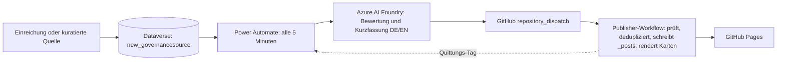

# Power Platform Governance

Dieses Repository ist die technische Basis von [powerplatformgovernance.com](https://powerplatformgovernance.com): einer kuratierten Sammlung von Kurzfassungen zu Microsoft Power Platform Governance (Security, Standards, ALM, DLP, Environment-Strategie, Dataverse, Power Apps, Power Automate, Copilot Studio und Betriebspraxis). Kuratierte Beiträge entstehen überwiegend automatisch: Power-Automate-Flows befüllen die Seite aus einer Quellenliste, und GitHub veröffentlicht sie. Eigene Artikel (15 Paare) und die Seiten unter `_tabs/` werden von Hand gepflegt. Stand: 30.09.2026.

## Zielbild und Umsetzung

- Chirpy-basierte Jekyll-Website auf GitHub Pages mit eigener Domain; Beiträge zweisprachig (DE und EN)
- Öffentliches Einreichungsformular, das einen Webhook-Flow aufruft und in Dataverse speichert
- Verarbeitungs-Flow alle 5 Minuten: Quellen prüfen (Artikel, RSS, YouTube, Podcast), Foundry-Bewertung, kurze DE-/EN-Zusammenfassung
- Neue Einreichungen werden autonom entschieden (Feed-Erkennung oder KI-Gate, ohne menschliche Prüfung)
- Übergabe per `repository_dispatch` an den Publisher-Workflow: er validiert, dedupliziert, schreibt beide Sprachen nach `_posts/`, rendert ein Karten-Bild je Beitrag und baut die Seite
- Zusätzlich: IndexNow, täglicher E-Mail-Digest über Brevo, Cookie-Einwilligung mit Google Analytics und Microsoft Clarity

## Architektur



Die Details stehen in den Dokumenten unten. Der Überblick über Freigabe, Quellarten und Betriebsgrenzen ist der Betriebsleitfaden.

## Technischer Stack

- Website: Jekyll und das Chirpy-Theme (Gem `jekyll-theme-chirpy`), Build und Deployment über GitHub Actions
- Quellenliste und Betriebsstatus: Dataverse, Tabelle `new_governancesource`
- Orchestrierung: zwei Power-Automate-Cloud-Flows, per Code erzeugt (`tools/automation.mjs`, `tools/intake.mjs`) und mit PowerShell bereitgestellt (`tools/deploy-automation.ps1`, `tools/deploy-intake.ps1`)
- KI: Azure AI Foundry über den eigenen Custom Connector `AzureAIFoundry-Privat` (`model-router` für Text, `whisper` für Audio)
- Veröffentlichung: GitHub-Connector, Workflow `Publish Curated Articles` (`tools/publish-curation.rb`)
- Karten-Bilder: `tools/render_card.py` (Python, Pillow); Digest: `tools/send_digest.py` (Brevo)

## Dokumentation

- [Betrieb und Freigabe](2026-09-18_architektur_automation_betrieb.md): Ablauf, Quellarten, autonome Freigabe, Sicherheit, Zeitlimits, Workflows, bekannte Lücken, Änderungsverlauf
- [Kuration, Quellen und Einreichungen](2026-09-18_architektur_kuration_und_quellen.md): redaktionelle Regeln, Einreichung, Quellenübersicht, SEO und GEO
- [Einreichung und Moderation](2026-09-18_architektur_submission_moderation.md) (englisch): Ablauf, Bewertungen, Zustände
- [RSS-Blog, Erstplanung](2026-09-18_architektur_rss_blog.md): historisch, mit Liste der Abweichungen der Umsetzung

Alle vier tragen im Dateinamen das Datum der Erstfassung. Sie wurden am 30.09.2026 an den Code angepasst; die Erstplanung ist als historisch gekennzeichnet.

## Lokal arbeiten und prüfen

Voraussetzungen: Ruby (CI nutzt 3.4), Node (in den Workflows nicht festgelegt, die Tests laufen mit Node 22), für die Bereitstellung PowerShell 7.4 und die Azure CLI. Die Karten-Bilder brauchen Python 3.12 mit Pillow und die Schrift Kalam; nur die CI lädt die Schriftdateien, lokal bricht `tools/render_card.py` ohne sie mit „Missing font“ ab.

```bash
export LC_ALL=C.UTF-8            # Ruby braucht UTF-8, sonst brechen Umlaute die Tests
bundle install
node --test tools/*.test.mjs
bundle exec ruby tools/test-publish-curation.rb
bash tools/test.sh               # Build, Seitenprüfung (tools/check-site.rb) und htmlproofer
bash tools/run.sh                # lokaler Server
```

## Geheimnisse und Variablen

Nie im Repository. Als GitHub-Actions-Secrets: `GOVERNANCE_SUBMISSION_ENDPOINT` (Callback des Einreichungs-Webhooks, wird beim Build eingebunden) und `BREVO_API_KEY` (Digest).

## Schwesterseite

[Power Platform News](https://powerplatformnews.com) ist in Vorbereitung und nicht live. Es nutzt dieselbe Engine mit eigenem Profil (`_data/profile.json`), eigener Tabelle und eigenen Flows. Den Konvergenz-Vertrag und die dort umgesetzten Verbesserungen beschreibt die Spezifikation im Repository `powerplatformnews.com` (Branch `ccr-453447c5-qyg2zo`, noch nicht gemerged).

## Offene Punkte

Siehe „Bekannte Lücken“ im Betriebsleitfaden.
